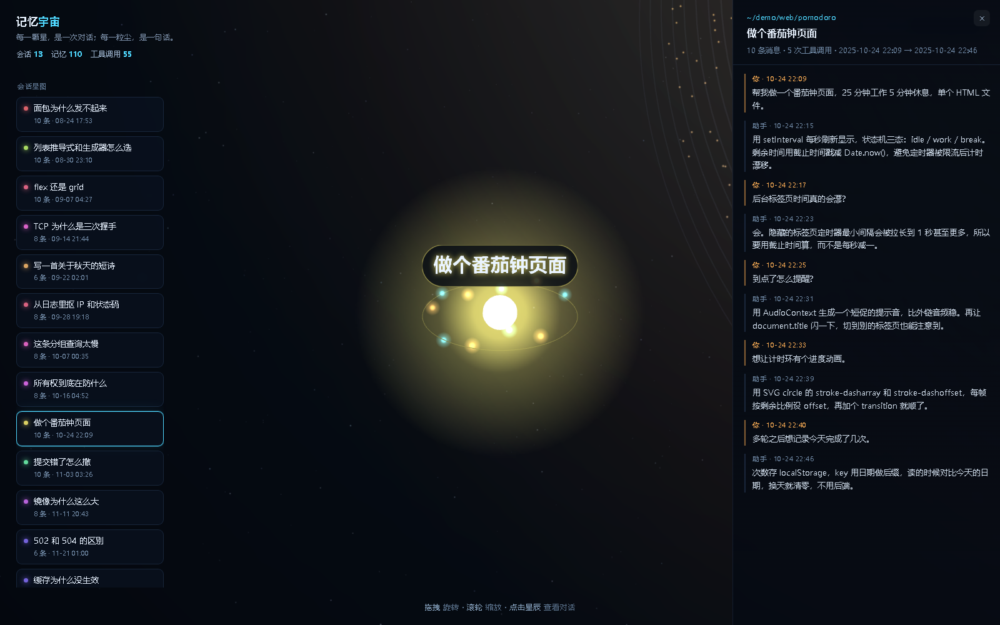

# 记忆宇宙 · Memory Universe

把一段段对话记录，渲染成一片可以飞行、可以点击的 3D 星图。
纯前端、零后端、零依赖安装，**一个 HTML 文件就能分享**。


> 每颗恒星 = 一次会话 · 每粒尘埃 = 一条消息（橙 = 你，青 = 助手）
> XZ 平面 = 话题相似度聚类 · Y 轴 = 时间（越新越靠上）

**[→ 在线演示](https://github.com/<your-name>/memory-universe)**
开启 GitHub Pages（Settings → Pages → Source: `deploy from a branch` → `/docs`）后，
这个地址就是内置示例数据的单文件版，不含任何真实对话。

---

## 它长什么样

| 开场全景 | 点开一次会话 |
|---|---|
|  |  |

- 转场式镜头：`拖拽` 旋转、`滚轮` 缩放、`点击星辰` 镜头飞过去并展开该会话全文
- 点击尘埃可以定位到那一条消息
- 搜索框按标题 / 内容过滤，命中的会话高亮
- 背景是一整个程序化生成的太阳系（恒星 + 尘埃盘 + 轨道环 + 八大行星 + 流星），不是贴图，没有任何外部素材

## 快速开始

克隆后什么都不用装，直接看效果：

```bash
git clone <this-repo>
cd memory-universe
python serve.py            # 打开 http://127.0.0.1:8099/
```

没有自己的数据时会自动加载 `web/memory.demo.json` 里的示例对话。
也可以用任意静态服务器，例如 `python -m http.server 8099 -d web`。

## 导入你自己的对话

仓库自带的 `export_memory.py` 面向 **DSH** 的会话日志
（`~/.dsh/sessions/<项目>/<会话id>/session.v4.jsonl.zstd`，zstd 压缩的 JSONL 事件流）：

```bash
pip install zstandard
python export_memory.py            # -> web/memory.json
python export_memory.py --stats    # 只打印统计，不写文件
python export_memory.py --max-text 800   # 每条只留 800 字
```

刷新页面就能看到自己的记忆。导出时默认会把家目录替换成 `~`，
可用 `--keep-paths` 关掉这层脱敏。

**用别的数据源？** 任何能生成下面这份 JSON 的脚本都可以，`export_memory.py` 只是其中一种实现：

```jsonc
{
  "generatedAt": 1756000000000,
  "sessions": [
    {
      "id": "s1",
      "project": "~/demo/cookbook",     // 右侧面板显示的位置
      "title": "面包为什么发不起来",
      "createdAt": 1756000000000,        // 毫秒时间戳
      "lastAt": 1756003600000,
      "msgCount": 10,
      "toolCount": 5,
      "messages": [
        { "role": "user", "text": "……", "at": 1756000000000, "seq": 1 },
        { "role": "assistant", "text": "……", "at": 1756000240000, "seq": 2 }
      ]
    }
  ]
}
```

只填 `title` / `createdAt` / `msgCount` / `messages` 也能跑，其余字段缺失会被忽略。

## 打成一个文件发给别人

```bash
python build_single.py               # -> memory-universe.html
python build_single.py --light       # 每条消息只留 80 字，体积更小
```

产物约 0.6–1.4 MB，双击用浏览器打开：不需要 Python、不需要服务器、不需要联网
（three.js 已内联）。原理是浏览器在 `file://` 下禁止 `fetch` 本地文件，
所以把所有资源内联进 HTML，数据挂在 `window.MEMORY` 上。

## 隐私

这个项目是按"数据只留在你本机"设计的：没有后端、没有上报、没有分析脚本，
页面唯一的网络请求是读同目录下的 `memory.json`。

但**分享前请自己确认**：

- `web/memory.json` 是你的真实对话原文，已在 `.gitignore` 里，别 `git add -f` 它
- `--light` 单文件版同样包含全部对话（只是每条截断到 80 字），别当成"脱敏"用
- 想只展示效果，就发示例数据构建出来的那份：`python build_single.py --data web/memory.demo.json`
- 提交截图前看一眼：截图里的会话标题就是你的对话标题

## 实现要点

1. **抽取**：只保留可见 `text`，丢掉 reasoning 和工具参数；过滤系统注入的伪用户消息。
2. **聚类**：中文没有空格，用**字符二元组**做 TF-IDF，再算余弦相似度；力导向布局（相似相吸、全体互斥）摊到 XZ 平面。
3. **时间轴**：`createdAt` 归一化后映射到 Y 轴，形成"记忆地层"。
4. **尘埃**：第 i 条消息按 `i × 0.55 rad` 螺旋外扩，自然形成星系盘。
5. **标签**：Canvas 贴图 + 每帧按相机距离缩放，任何缩放下都保持可读。
6. **流星**：一张"纵向渐变 + 横向羽化"的贴图做成 billboard，每帧把运动方向投影到屏幕空间算旋转角，
   拖尾始终顺着飞行方向；不靠粒子堆，所以任何分辨率下都是连续光带而不是点珠。
7. **太阳系**：46 圈 `RingGeometry` 环面 + 11,000 粒尘埃盘 + 8 颗行星，接近侧视的盘面拉成长椭圆当背景，
   恒星放在盘边缘做逆光，角速度近似 ∝ 1/√r。

## 调试参数

| 参数 | 作用 |
|---|---|
| `?focus=3` | 开局直接聚焦第 4 个会话 |
| `?warm=4.5` | 先把动画快进 4.5 秒再渲染（截图 / 演示用） |
| `?debug=1` | 把流星状态写进网页标题，排查渲染问题 |

> 用 `--virtual-time-budget` 截图时 `performance.now()` 不前进，
> 动画会永远停在 t≈0，必须配 `?warm=` 才能拿到中间帧。

## 文件

```
memory-universe/
├── export_memory.py          会话流水 -> memory.json（DSH 版导出器）
├── build_single.py           打包成单个 HTML
├── serve.py                  本地起服务 + 打开浏览器
├── tools/make_demo_data.py   重建示例数据 web/memory.demo.json
├── web/
│   ├── index.html
│   ├── app.js                Three.js 场景 / 布局 / 交互
│   ├── style.css
│   ├── memory.demo.json      内置示例对话（虚构，可安全提交）
│   └── vendor/three.min.js   three.js r128 (MIT)
├── docs/                     截图 + 示例数据构建出的单文件演示页
├── LICENSE                   MIT
└── THIRD-PARTY-NOTICES.md
```

## 可以继续做的方向

- 换成语义向量（任意 embedding API）替代字符二元组，聚类更准
- 把工具调用也画成节点，看到"对话里到底发生了什么"
- 加时间轴滑块，回放记忆的生长过程
- IndexedDB 缓存全文，支撑上千次会话

## English

A dependency-free 3D star map for your chat history: each conversation becomes a
star, each message a grain of dust. Topic clustering on the XZ plane (TF-IDF over
character bigrams), time on the Y axis, procedurally generated solar system in the
background. Pure Three.js, no build step, no backend, no network calls.

```bash
python serve.py                      # demo data, http://127.0.0.1:8099/
python export_memory.py              # import DSH transcripts -> web/memory.json
python build_single.py --light       # one shareable .html file
```

All content in `web/memory.demo.json` is fictional; `web/memory.json` (your real
conversations) is gitignored on purpose.

MIT licensed. See `LICENSE`.

## License

[MIT](LICENSE) · three.js is MIT, see [THIRD-PARTY-NOTICES.md](THIRD-PARTY-NOTICES.md)