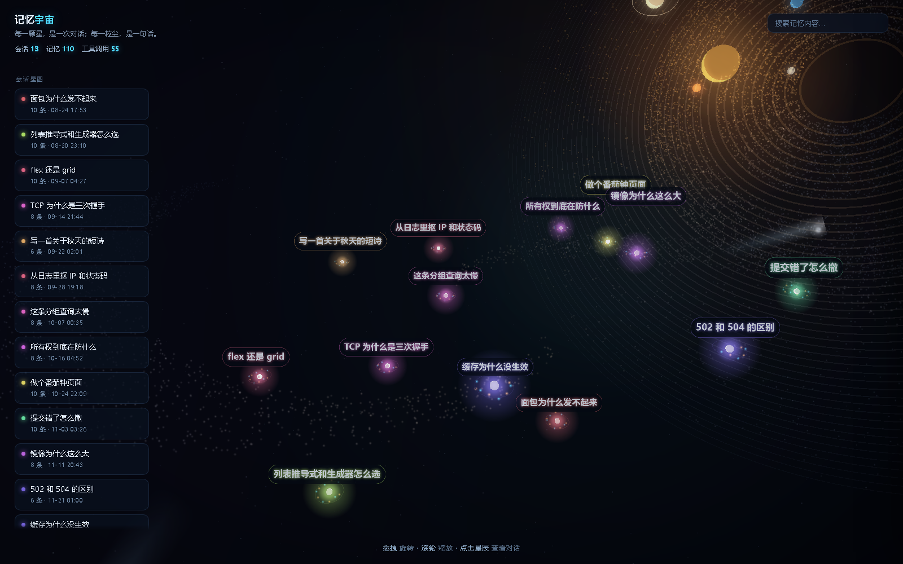

<div align="center">

# 记忆宇宙 · Memory Universe

**把一段段对话记录，变成一片可以飞行、可以点击的 3D 星系**

[](LICENSE)
[](https://threejs.org)
[](#)
[](#打成一个文件发给别人)

**[在线体验](https://weitakaodaxue.github.io/memory-universe/)** ·
[快速开始](#快速开始) ·
[导入自己的数据](#导入你自己的对话) ·
[实现要点](#实现要点)



</div>

> 每颗恒星 = 一次会话 · 每粒尘埃 = 一条消息（橙 = 你，青 = 助手）
> XZ 平面 = 话题相似度聚类 · Y 轴 = 时间（越新越靠上）

## 特性

**视觉**
- 自写的后期处理管线：亮部提取 → 两轮可分离高斯模糊 → 叠加合成，给星辰加上柔和辉光与暗角
- 程序化星系：两条对数螺旋旋臂、11,000 粒尘埃星盘、46 圈环面、8 颗行星、流星拖尾，**全部由代码生成，零贴图素材**
- 星团沿旋臂剪切排布，话题聚类与星系旋臂两套结构叠在一起
- 标签自动避让：屏幕空间里检测重叠并向上错位，任何缩放下都不会糊成一团
- 开场「星际跃迁」：环形冲击波 + 镜头从 2.4 倍距离缓动推入

**交互**
- 悬停星辰：光晕放大 1.45 倍，并向最近的 3 颗星拉出连线
- 点击星辰 / 侧边栏：相机用 `easeInOutCubic` 缓动推入，面板打开时视线中心自动右移，不会挡住目标
- 鼠标移动产生视差，星场与星云按不同速度缓慢自转
- 搜索：左侧列表实时过滤，宇宙里不相关的星辰平滑黯淡退隐
- 消息逐条渐入；`← / →` 切换会话，`Esc` 关闭面板

**工程**
- 纯静态：无构建、无后端、无网络请求，双击即开
- 性能兜底：连续掉帧会自动关闭泛光（也可以手动 `?bloom=0`）
- 也能打成 **一个 0.6 MB 的 HTML 文件**，发微信、丢 U 盘、双击就能看

## 快速开始

克隆后什么都不用装：

```bash
git clone https://github.com/weitakaodaxue/memory-universe.git
cd memory-universe
python serve.py            # 打开 http://127.0.0.1:8099/
```

没有自己的数据时会自动加载 `web/memory.demo.json` 里的虚构示例对话。

## 导入你自己的对话

`export_memory.py` 面向 **DSH** 的会话日志
（`~/.dsh/sessions/<项目>/<会话id>/session.v4.jsonl.zstd`，zstd 压缩的 JSONL 事件流）：

```bash
pip install zstandard
python export_memory.py                  # -> web/memory.json
python export_memory.py --stats          # 只打印统计，不写文件
python export_memory.py --max-text 800   # 每条只留 800 字
```

刷新页面即可。导出时默认把家目录替换成 `~`，`--keep-paths` 可以关掉这层脱敏。

**用别的数据源？** 任何能产出下面这份 JSON 的脚本都行：

```jsonc
{
  "generatedAt": 1756000000000,
  "sessions": [
    {
      "id": "s1",
      "project": "~/demo/cookbook",     // 面板里显示的位置
      "title": "面包为什么发不起来",
      "createdAt": 1756000000000,        // 毫秒时间戳
      "lastAt": 1756003600000,
      "msgCount": 10,
      "toolCount": 5,
      "messages": [
        { "role": "user", "text": "……", "at": 1756000000000, "seq": 1 },
        { "role": "assistant", "text": "……", "at": 1756000240000, "seq": 2 }
      ]
    }
  ]
}
```

只填 `title` / `createdAt` / `msgCount` / `messages` 也能跑。

## 打成一个文件发给别人

```bash
python build_single.py               # -> memory-universe.html
python build_single.py --light       # 每条消息只留 80 字，体积更小
python build_single.py --data web/memory.demo.json --out demo.html
```

产物双击用浏览器打开：不需要 Python、不需要服务器、不需要联网（three.js 已内联）。
原理是浏览器在 `file://` 下禁止 `fetch` 本地文件，所以把所有资源内联进 HTML，
数据挂在 `window.MEMORY` 上。

## URL 参数

| 参数 | 作用 |
|---|---|
| `?focus=3` | 开局直接聚焦第 4 个会话 |
| `?warm=4.5` | 先把动画预演 4.5 秒再渲染（截图 / 演示用） |
| `?bloom=0` | 关闭后期泛光（低配机器） |
| `?swirl=0` | 关闭星系漩涡，回到纯力导向布局 |
| `?boot=0` | 跳过开场动画 |
| `?debug=1` | 把泛光 / 悬停 / 流星状态写进网页标题 |

> 用 `--virtual-time-budget` 截图时 `performance.now()` 不前进，
> 动画会停在 t≈0，必须配 `?warm=` 才能拿到中间帧。

## 实现要点

1. **抽取**：只保留可见 `text`，丢掉 reasoning 与工具参数；过滤系统注入的伪用户消息。
2. **聚类**：中文没有空格，用**字符二元组**做 TF-IDF 再算余弦相似度；力导向布局（相似相吸、全体互斥）摊到 XZ 平面。
3. **旋臂**：对每个坐标做 `θ += k·ln(r/r₀)` 的剪切变换，星团顺势排进背景星系的两条旋臂。
4. **时间轴**：`createdAt` 归一化后映射到 Y 轴，形成"记忆地层"。
5. **尘埃**：第 i 条消息按 `i × 0.55 rad` 螺旋外扩，自然形成星系盘。
6. **泛光**：没有用 `UnrealBloomPass`（那需要 examples 里的额外模块），而是用三个 `WebGLRenderTarget`
   自己拼了一条 亮部提取 → 水平/垂直两轮模糊 → 叠加合成 的管线，约 120 行，r128 单文件即可运行。
7. **流星**：一张"纵向渐变 + 横向羽化"的贴图做成 billboard，每帧把运动方向投影到屏幕空间算旋转角，
   拖尾始终顺着飞行方向；不靠粒子堆，任何分辨率下都是连续光带而不是点珠。
8. **太阳系**：46 圈 `RingGeometry` 环面 + 11,000 粒尘埃盘 + 8 颗行星，接近侧视的盘面拉成长椭圆当背景，
   恒星放在盘边缘做逆光，角速度近似 ∝ 1/√r。

## 性能

默认开启泛光时，独显机器基本满帧；核显（如 Intel UHD）在 1600×1000 下大约 30–45 FPS，
连续掉帧会自动降级关掉泛光。想要更稳就加 `?bloom=0`，视觉上仍有光晕贴图兜底。

## 文件

```
memory-universe/
├── export_memory.py          会话流水 -> memory.json（DSH 版导出器）
├── build_single.py           打包成单个 HTML
├── serve.py                  本地起服务 + 打开浏览器
├── tools/make_demo_data.py   重建示例数据 web/memory.demo.json
├── tools/privacy_check.py    发布前扫描：绝对路径 / 密钥 / 邮箱 / 手机号
├── web/
│   ├── index.html
│   ├── app.js                Three.js 场景 / 布局 / 泛光 / 交互
│   ├── style.css
│   ├── memory.demo.json      内置示例对话（虚构，可安全提交）
│   └── vendor/three.min.js   three.js r128 (MIT)
├── docs/                     截图 + 示例数据构建出的单文件演示页
├── LICENSE                   MIT
└── THIRD-PARTY-NOTICES.md
```


## 隐私

这个项目按"数据只留在你本机"设计：没有后端、没有上报、没有分析脚本，
页面唯一的网络请求是读同目录下的 `memory.json`。

但**分享前请自己确认**：

- `web/memory.json` 是你的真实对话原文，已在 `.gitignore` 里，别 `git add -f` 它
- `--light` 单文件版同样包含全部对话（只是每条截断到 80 字），别当成脱敏工具
- 想只展示效果，就发示例数据构建出来的那份：`python build_single.py --data web/memory.demo.json`
- 提交截图前看一眼：截图里的会话标题就是你的对话标题

提交前顺手扫一遍：

```bash
python tools/privacy_check.py --token 你的名字 --token 你的公司
```

默认只扫 **git 跟踪的文件**——也就是真正会发上 GitHub 的那些，所以本地留着的
`web/memory.json`、个人单文件版不会造成误报；想连本地数据一起查用 `--all`
（那些命中是预期的，别提交就行）。

CI 里挂了同样的检查（`.github/workflows/privacy.yml`），并且会拦住误提交的 `web/memory.json`。

## 可以继续做的方向

- 换成语义向量（任意 embedding API）替代字符二元组，聚类更准
- 把工具调用也画成节点，看到"对话里到底发生了什么"
- 加时间轴滑块，回放记忆的生长过程
- IndexedDB 缓存全文，支撑上千次会话

## English

A dependency-free 3D star map for your chat history: each conversation becomes a
star, each message a grain of dust. Topic clustering on the XZ plane (TF-IDF over
character bigrams), time on the Y axis, a procedural spiral galaxy and solar system
in the background, and a hand-written bloom pipeline (no post-processing addons).

```bash
python serve.py                      # demo data, http://127.0.0.1:8099/
python export_memory.py              # import DSH transcripts -> web/memory.json
python build_single.py --light       # one shareable .html file
```

Everything in `web/memory.demo.json` is fictional; `web/memory.json` (your real
conversations) is gitignored on purpose.

## License

[MIT](LICENSE) · three.js is MIT, see [THIRD-PARTY-NOTICES.md](THIRD-PARTY-NOTICES.md)
